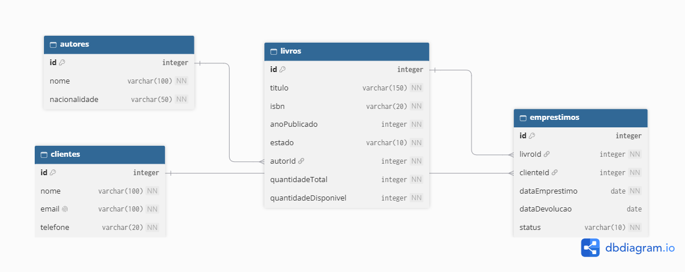

# 📚 BookStore Manager CLI

Aplicação de linha de comando (CLI) para gerenciar uma livraria: autores, livros, clientes e empréstimos. Projeto final do Módulo 01 do curso Desenvolvedor Back-End Node.js (SCTEC).

## 🎯 Objetivo

Aplicar na prática os conteúdos do módulo: lógica de programação, TypeScript, orientação a objetos, programação assíncrona, arquitetura em camadas, banco de dados relacional (PostgreSQL) e versionamento com Git e GitHub.

## 🎥 Vídeo de apresentação

🎬 [BookStore Manager CLI - Pamela Cruz](https://drive.google.com/file/d/1oxOaiAZqhbKL4JgbC2o5iRDjUjX82qRb/view?usp=drivesdk)

## 🛠️ Tecnologias utilizadas

- **Node.js** (testado na versão 24)
- **TypeScript**
- **prompt-sync** (leitura do teclado no terminal)
- **PostgreSQL** e **pgAdmin 4** (projeto do banco de dados)
- **dbdiagram.io** (Diagrama Entidade-Relacionamento)
- **Git** e **GitHub** (versionamento e Kanban no GitHub Projects)

## ✅ Requisitos para execução

- Node.js instalado (versão 18 ou superior)
- npm (já vem com o Node.js)
- Git
- PostgreSQL e pgAdmin 4 (somente para executar o script do banco)

## 📥 Instalação

```bash
git clone https://github.com/CruzPamela/bookstore-manager-cli.git
cd bookstore-manager-cli
npm install
```

## ▶️ Execução

```bash
npm run dev
```

O comando `npm run dev` compila o TypeScript (`tsc`) e executa a aplicação (`node dist/main.js`).

Para apenas compilar:

```bash
npm run build
```

> Os dados ficam **em memória**: ao encerrar a aplicação, tudo o que foi cadastrado é perdido. Ao iniciar, um **seed** carrega dados de exemplo (3 autores, 5 livros, 3 clientes e 2 empréstimos ativos). Todos os nomes e e-mails do seed são fictícios.

## 🗄️ Banco de dados (PostgreSQL)

A aplicação **não se conecta** ao banco. O banco de dados é um projeto separado, na pasta `database/`:

- `database/der.png`: Diagrama Entidade-Relacionamento
- `database/script.sql`: criação das tabelas (DDL), inserção, atualização e remoção de dados (DML) e consultas dos relatórios

### Diagrama Entidade-Relacionamento (DER)



Relacionamentos:
- Um **autor** pode ter vários **livros** (1:N).
- Um **livro** pode aparecer em vários **empréstimos** (1:N).
- Um **cliente** pode ter vários **empréstimos** (1:N).

### Como executar o script SQL

1. Abra o **pgAdmin 4** e conecte no seu servidor PostgreSQL.
2. Clique com o botão direito em **Databases** → **Create** → **Database...**, dê o nome `bookstore` e salve.
3. Clique com o botão direito na database `bookstore` → **Query Tool**.
4. Abra o arquivo `database/script.sql`, copie todo o conteúdo e cole na Query Tool.
5. Pressione **F5** (ou o botão ▶) para executar.
6. Para ver o resultado de uma consulta específica, selecione apenas ela e pressione **F5**.

> O script começa com `DROP TABLE IF EXISTS`, então pode ser executado mais de uma vez sem erro.
> O PostgreSQL mostra os nomes de colunas em minúsculas (ex.: `anoPublicado` aparece como `anopublicado`).
> Nenhuma senha ou credencial é guardada no script.

Relatórios incluídos no script:
1. Livros disponíveis
2. Livros emprestados (empréstimos ativos)
3. Quantidade de livros por autor
4. Quantidade de empréstimos por livro
5. Clientes com empréstimos ativos
6. Extras: os 3 livros mais emprestados (`LIMIT`) e total de exemplares (`SUM`)

## 🏗️ Arquitetura do projeto

A aplicação é organizada em **camadas**, cada uma com uma responsabilidade:

| Camada | Responsabilidade |
|---|---|
| **models** | Interfaces e classes das entidades (Autor, Livro, Cliente, Emprestimo) |
| **repositories** | Guardam os dados em memória (arrays) e fazem buscas |
| **services** | Regras de negócio e validações (lançam erros com `throw new Error`) |
| **controllers** | Conversam com o usuário: leem os dados, chamam o service e tratam erros com `try/catch` |
| **menus** | Exibem as opções de cada área (`while` + `switch`) |
| **main.ts** | Monta as camadas (repositórios → services → controllers → menus), carrega o seed e abre o menu principal |

Os métodos de services e repositories são **assíncronos** (`async/await` e `Promise`).

## ⚙️ Funcionalidades implementadas

**Autores:** cadastrar, listar, buscar por ID, atualizar e remover.

**Livros:** cadastrar (com autor existente), listar, buscar por ID, atualizar e remover.

**Clientes:** cadastrar, listar, buscar por ID, atualizar e remover.

**Empréstimos:** realizar empréstimo, registrar devolução e listar (com título do livro, nome do cliente, data e status).

### Regras de negócio

- Livro duplicado = mesmo **ISBN** e mesmo **estado** (novo/usado). O mesmo ISBN pode existir como "novo" e como "usado".
- O e-mail do cliente é **único** e precisa conter `@`.
- Campos obrigatórios não podem ficar vazios; números inválidos são recusados.
- Empréstimo só acontece se o livro tiver exemplar disponível; ele **diminui 1** da quantidade disponível.
- A devolução **soma 1** na quantidade disponível; um empréstimo já devolvido não pode ser devolvido de novo.
- Cada cliente pode ter **no máximo 2 empréstimos ativos**.
- Não é possível remover um **autor que possui livros**.
- Não é possível remover um **livro** ou um **cliente** com **empréstimo ativo**.
- Ao atualizar um livro, a nova quantidade total não pode ser menor que o número de exemplares emprestados.

## 📁 Estrutura de pastas

```
bookstore-manager-cli/
├── database/
│   ├── der.png              # Diagrama Entidade-Relacionamento
│   └── script.sql           # DDL, DML e relatórios
├── src/
│   ├── controllers/         # Conversa com o usuário (try/catch)
│   │   ├── AutorController.ts
│   │   ├── ClienteController.ts
│   │   ├── EmprestimoController.ts
│   │   └── LivroController.ts
│   ├── data/
│   │   └── seed.ts          # Dados iniciais fictícios
│   ├── menus/               # Opções de cada área (while + switch)
│   │   ├── AutorMenu.ts
│   │   ├── ClienteMenu.ts
│   │   ├── EmprestimoMenu.ts
│   │   └── LivroMenu.ts
│   ├── models/              # Interfaces e classes das entidades
│   │   ├── Autor.ts
│   │   ├── Cliente.ts
│   │   ├── Emprestimo.ts
│   │   └── Livro.ts
│   ├── repositories/        # Dados em memória (arrays)
│   │   ├── AutorRepository.ts
│   │   ├── ClienteRepository.ts
│   │   ├── EmprestimoRepository.ts
│   │   └── LivroRepository.ts
│   ├── services/            # Regras de negócio e validações
│   │   ├── AutorService.ts
│   │   ├── ClienteService.ts
│   │   ├── EmprestimoService.ts
│   │   └── LivroService.ts
│   ├── utils/
│   │   └── prompt.ts        # Leitura do teclado (prompt-sync)
│   └── main.ts              # Monta as camadas, carrega o seed e abre o menu
├── .gitattributes
├── .gitignore
├── package.json
├── package-lock.json
├── tsconfig.json
└── README.md
```

## 💡 Exemplos de utilização

Menu principal:

```
=== BOOKSTORE MANAGER ===
1 - Autores
2 - Livros
3 - Clientes
4 - Empréstimos
0 - Encerrar aplicação
Escolha uma opção:
```

Realizando um empréstimo (Empréstimos → 1):

```
=== EMPRÉSTIMOS ===
1 - Realizar empréstimo
2 - Registrar devolução
3 - Listar empréstimos
0 - Voltar
Escolha uma opção: 1
ID do livro: 4
ID do cliente: 1
Empréstimo registrado com o id 3.
```

Tentando um 3º empréstimo para o mesmo cliente:

```
Erro: O cliente Ana Lima já tem 2 empréstimos ativos (limite máximo).
```

Tentando remover um autor que tem livros:

```
Erro: Não é possível remover: o autor possui livros cadastrados.
```

## 🌿 Versionamento

Fluxo de branches utilizado: `main`, `develop` e uma branch para cada funcionalidade (`feat/autores`, `feat/livros`, `feat/clientes`, `feat/emprestimos`, `feat/seed`, `feat/banco-dados`, `docs/readme`). Cada funcionalidade foi desenvolvida na sua branch, integrada na `develop` e, ao final, a `develop` foi integrada na `main`. Os commits seguem o padrão semântico (`feat:`, `fix:`, `docs:`).

## 📋 Kanban

Acompanhamento das tarefas no GitHub Projects: https://github.com/users/CruzPamela/projects/2

## 🚀 Melhoria futura

- Numerar cada exemplar do livro individualmente, para saber exatamente qual exemplar está emprestado.

## 👩‍💻 Integrantes da equipe

- Pamela Cruz (GitHub: [CruzPamela](https://github.com/CruzPamela))
